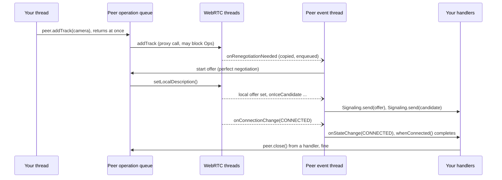

# webrtc-java Client API

Status: phase 1 implemented on the `client-api` branch, based on `main` at 6cc938ab. See
[Implementation status](#implementation-status) for where the code differs from this design.

A high-level layer over the existing JNI API. It owns every native object, gives application code
one thread per peer, negotiates on its own, and returns futures instead of nested observers. The
low-level API stays as it is.

- Package `dev.onvoid.webrtc.client`, in the existing `webrtc-java` jar, exported by the
  `webrtc.java` module.
- Java 8, like the rest of the module: no records, no sealed types, no `var`.
- Pure Java. Phase 1 needs no native or JNI changes and changes no existing signature.

## Decisions

These were open questions in the mockup. Each went with its recommendation.

| Question | Decision | Consequence |
|---|---|---|
| Where does it live? | A package in the existing jar, not a separate artifact. | Users get it without another dependency. It follows the core's releases. |
| Default perfect negotiation role? | Impolite by default. | Glare between two impolite peers fails with a `NegotiationException` that names the fix (make one side polite). Every example sets the role explicitly. |
| Plain `CompletableFuture` or an own type? | Plain `CompletableFuture`. | On Java 8, stages derived from a subclass are plain `CompletableFuture`s, so `BlockingCallException` only catches a `join()`/`get()` on the future the API returned. The exception message and the event thread names help with the rest. |
| Does `Peer.close()` block? | No, never. | Safe in handlers and on UI threads. `closeAsync()` returns a future for callers who want to wait. `WebRtc.close()` is the one call that waits for everything. |
| A camera opened twice? | Shared when the options match, `MediaException` when they differ. | One capture per device. Most platforms can't open a device with two capabilities anyway. |
| Entry point name? | `WebRtc`. | `try (WebRtc rtc = WebRtc.create()) { ... }` |

## What hurts today

Each row comes from the current code, docs or examples on `main`.

| Problem | Where it shows | Answer |
|---|---|---|
| Observers run on WebRTC's own threads | `PeerConnectionObserver` is called on the signaling thread. A handler that blocks, or waits for work that needs that thread, stalls every connection of the factory. | Native callbacks only copy and enqueue. Handlers run on a per-peer event thread, where they may block or call `close()`. |
| Threading rules differ per class | Data channel send results, DTLS and injector observers go through `JavaCallbackThread`. Peer connection observers don't. Frame sinks run on capture and decode threads. Custom audio has to be pushed from a single thread. | One rule for all control events. Frames get their own documented thread with a drop policy. Custom audio is serialized by the library. |
| Nested callbacks for offer and answer | `createOffer` → `CreateSessionDescriptionObserver` → `setLocalDescription` → `SetSessionDescriptionObserver`, with the error as a `String`. `WhepExample` uses three `CountDownLatch`es to flatten it. | `CompletableFuture` everywhere, failing with typed exceptions. In automatic mode the application never calls offer or answer. |
| Signaling correctness is left to the app | Glare, rollback, candidates that arrive before the remote description (they fail silently with the plain `addIceCandidate`), and `onRenegotiationNeeded` firing mid-negotiation. | Built-in perfect negotiation with a polite/impolite role, candidate queuing, and a browser-compatible JSON message format. |
| Manual disposal of query results | Every `RTCRtpSender`, `RTCRtpReceiver` and `RTCRtpTransceiver` returned to the app must be disposed, sources are not owned by tracks, and the factory has to outlive its connections. | No `dispose()` in the API. Everything is `AutoCloseable`, owned by its creator, and closed in the right order. |
| Receive-only needs a dummy track | `WhepExample` creates a `VideoDeviceSource` and a `VideoTrack` only to pass them to a `RECV_ONLY` transceiver. | `PeerOptions.receive(VIDEO, AUDIO)`. |
| Audio input mode is found at run time | Mixing device and custom audio in one factory throws `IllegalStateException` on the first track of the other kind. | `AudioMode` is chosen when the runtime is built. The wrong call fails at once with a message naming the mode. |
| Device queries can block the caller | The guides say to query devices on worker threads, never on UI or render threads. | `Devices` is a snapshot kept current in the background, so reading it is instant on any thread. |

## Before and after

A video call over a WebSocket. Today the web example spreads this over `PeerConnectionManager`
(460 lines) and `MediaManager` (274 lines). This is the core of it, shortened:

```java
PeerConnectionFactory factory = new PeerConnectionFactory();
RTCConfiguration config = new RTCConfiguration();
RTCIceServer iceServer = new RTCIceServer();
iceServer.urls.add("stun:stun.l.google.com:19302");
config.iceServers.add(iceServer);

RTCPeerConnection pc = factory.createPeerConnection(config, new PeerConnectionObserver() {
    @Override
    public void onIceCandidate(RTCIceCandidate candidate) {
        socket.send(toJson(candidate));        // runs on WebRTC's signaling thread
    }

    @Override
    public void onRenegotiationNeeded() {
        createOffer();                         // glare and rollback are up to you
    }

    @Override
    public void onTrack(RTCRtpTransceiver transceiver) {
        RTCRtpReceiver receiver = transceiver.getReceiver();
        MediaStreamTrack track = receiver.getTrack();
        if (track instanceof VideoTrack) {
            ((VideoTrack) track).addSink(frame -> view.render(frame));
        }
        receiver.dispose();                    // query results are yours to dispose
        transceiver.dispose();
    }
});

void createOffer() {
    pc.createOffer(new RTCOfferOptions(), new CreateSessionDescriptionObserver() {
        @Override
        public void onSuccess(RTCSessionDescription offer) {
            pc.setLocalDescription(offer, new SetSessionDescriptionObserver() {
                @Override
                public void onSuccess() { socket.send(toJson(offer)); }

                @Override
                public void onFailure(String error) { log.error(error); }
            });
        }

        @Override
        public void onFailure(String error) { log.error(error); }
    });
}

// Not shown: answering, queuing early candidates, JSON parsing, creating and
// disposing sources, tracks and senders, closing pc before disposing factory.
```

With the client API, this is the whole thing:

```java
try (WebRtc rtc = WebRtc.create()) {
    Peer peer = rtc.createPeer(PeerOptions.builder()
            .iceServer("stun:stun.l.google.com:19302")
            .polite(joinedSecond)
            .signaling(message -> socket.send(message.toJson()))
            .build());
    socket.onText(text -> peer.signal(SignalMessage.fromJson(text)));

    peer.addTrack(rtc.media().microphone());
    peer.addTrack(rtc.media().camera());

    peer.onTrack(track -> {
        if (track.isVideo()) {
            track.asVideo().onFrame(frame -> view.render(frame));
        }
    });
    peer.onStateChange(state -> log.info("Call is {}", state));

    peer.whenConnected().join();       // fine here: this is not an event thread
    hangUp.await();
}   // closes the peer, the camera, the microphone and the factory, in that order
```

## Threading model

The model borrows from Netty's event loop: each peer has one event thread for application code,
and the library never runs application code on a thread WebRTC needs.



> **Invariant the implementation must keep:** nothing the library runs on a WebRTC thread ever
> waits for a Java thread. Native observers copy their arguments, enqueue, and return. That rules
> out the deadlock cycle no matter what a handler does.

| Code | Runs on | May it block? |
|---|---|---|
| Calls into the API | the caller's thread, any thread | They don't block. The only exceptions are `WebRtc.close()`, which waits up to `closeTimeout`, and a `join()` the caller writes. |
| Event handlers, future callbacks, `Signaling.send` | the peer's event thread, or the configured `eventExecutor` | Yes, but it only delays that peer's events. It must not `join()` a future of this API: a direct `join()`/`get()` throws `BlockingCallException`. |
| Frame handlers (`onFrame`, `onAudio`) | one frame thread per subscription | Better not. A slow video handler gets the newest frame next, and the frames in between are dropped and released. |
| Native calls | internal operation threads | Not application code. Each operation has a timeout (default 30 s), so a stuck native call fails with a `TimeoutException` instead of hanging. |
| WebRTC callbacks | signaling, network and capture threads | Not application code. The library copies and enqueues only. |

### Guarantees

1. **Every method is thread-safe.** It can be called from any thread, including from inside a
   handler of the same peer.
2. **One peer, one thread at a time.** A peer's handlers and future callbacks never run
   concurrently, and they run in event order. Different peers may run in parallel unless the
   configured executor is serial, such as the Swing EDT.
3. **Order is kept with any executor.** A pool passed as `eventExecutor` is wrapped per peer, so
   ordering holds whatever executor is given.
4. **No lost events from registration races.** `onStateChange` is called with the current state
   first. `onTrack` and `onChannel` replay what already arrived. A data channel keeps the messages
   that arrive before its first `onMessage` handler.
5. **Operations run in order.** Each peer runs its operations one at a time, like the W3C
   operations chain. `addTrack` followed by `createChannel` always negotiates both, in that order.
6. **Close is final and quiet.** After `close()` the only event is `onStateChange(CLOSED)`. Pending
   futures fail with `PeerClosedException`, and later calls fail the same way instead of crashing
   in native code.
7. **Handler exceptions are contained.** An exception thrown by a handler goes to the runtime's
   `errorHandler`. It never stops delivery and never crosses into native code.

## Ownership and lifecycle

There is no `dispose()` in this API. You close what you created, and closing an owner closes what
it owns. Senders, receivers and transceivers are queried and disposed inside the library and are
never handed out.

| Object | Created by | Closed by | Closing it also |
|---|---|---|---|
| `WebRtc` | the application | the application, usually try-with-resources | closes all peers, then all local tracks and the device watcher, then disposes the factory and stops its threads |
| `Peer` | `rtc.createPeer` | the application, or `WebRtc` | closes its data channels and ends its remote tracks. Local tracks stay open for other peers. |
| `LocalVideo`, `LocalAudio` | `rtc.media()` | the application, or `WebRtc` | detaches the track from every peer it was sent on (no renegotiation), stops capture, releases the source |
| `Sender` | `peer.addTrack` | `sender.remove()`, or the peer | renegotiates in automatic mode. The track stays open. |
| `DataChannel` | `peer.createChannel`, or the remote side | the application, or the peer | completes pending sends with `PeerClosedException` |
| `RemoteTrack` | the peer | the peer, when the remote side removes it or the peer closes | calls `onEnded` and ends its frame subscriptions |
| `Subscription` | every `on…` method | the application, or the owner of the event | removes the handler |

## API surface

Signatures only. Value types reuse the existing ones where they are plain data
(`RTCSessionDescription`, `RTCIceCandidate`, `VideoFrame`, `AudioOptions`, `VideoDevice`,
`AudioDevice`, `DesktopSource`).

### `WebRtc`, the runtime

The entry point. It owns the `PeerConnectionFactory`, the audio device module, the library's
threads, and everything created through it.

```java
public final class WebRtc implements AutoCloseable {

    public static WebRtc create();                   // microphone and speakers, built-in codecs
    public static Builder builder();

    public Peer createPeer(PeerOptions options);
    public LocalMedia media();                       // cameras, microphones, screens, custom sources
    public List<Peer> peers();                       // snapshot of the open peers

    public CompletableFuture<Void> closeAsync();
    @Override
    public void close();                             // peers, then tracks, then the factory; waits up to closeTimeout

    public static final class Builder {
        public Builder audio(AudioMode mode);                       // DEVICES by default
        public Builder audioProcessing(AudioProcessingConfig config);
        public Builder hardwareVideoCodecs(boolean enabled);        // GPU encoders and decoders where present
        public Builder fieldTrials(Map<String, String> fieldTrials);
        public Builder eventExecutor(Executor executor);            // e.g. SwingUtilities::invokeLater, Platform::runLater
        public Builder errorHandler(Consumer<Throwable> handler);   // handler exceptions, failures nobody observed
        public Builder operationTimeout(Duration timeout);          // default 30 s
        public Builder closeTimeout(Duration timeout);              // default 10 s
        public Builder configureFactory(Consumer<PeerConnectionFactory.Builder> customizer);
        public WebRtc build();
    }
}

public enum AudioMode {
    DEVICES,    // capture the microphone, play to the speakers
    CUSTOM,     // send audio you push, play remote audio to the speakers
    HEADLESS    // no audio hardware: send audio you push, read remote audio through onAudio
}
```

- `AudioMode` moves the factory's device-or-custom rule to build time. `media().microphone()` on a
  `CUSTOM` runtime throws `ConfigurationException` saying why.
- `HEADLESS` uses `HeadlessAudioDeviceModule`, so servers and bots run without audio hardware.
- Library threads are daemon threads named after their peer (`webrtc-client-events-alice`), so
  thread dumps show which peer is busy.

### `PeerOptions`

```java
public final class PeerOptions {

    public static Builder builder();

    public static final class Builder {
        public Builder name(String name);                                // thread names, logs
        public Builder iceServer(String... urls);                        // "stun:host:3478", "turn:host" without credentials
        public Builder iceServer(String url, String username, String password);
        public Builder relayOnly(boolean relayOnly);                     // TURN candidates only
        public Builder signaling(Signaling signaling);                   // required with Negotiation.AUTOMATIC
        public Builder polite(boolean polite);                           // perfect negotiation role, default false
        public Builder negotiation(Negotiation negotiation);             // AUTOMATIC by default, or MANUAL
        public Builder receive(MediaKind... kinds);                      // receive-only audio and video
        public Builder configure(Consumer<RTCConfiguration> customizer); // anything else RTCConfiguration has
        public PeerOptions build();
    }
}

public enum Negotiation { AUTOMATIC, MANUAL }
public enum MediaKind { AUDIO, VIDEO }
```

### `Peer`, one connection

A connection to one remote peer. Methods that change it return at once and run on the peer's
operation queue, in order.

```java
public interface Peer extends AutoCloseable {

    String name();
    PeerState state();                                         // the last state, cached on the Java side

    // Signaling input: hand over what the remote side sent, in the order it was sent.
    void signal(SignalMessage message);

    // Sending. In AUTOMATIC mode each change renegotiates by itself.
    Sender addTrack(LocalTrack track, String... streamIds);
    List<Sender> senders();

    // Receiving. Late subscribers get the tracks that already arrived.
    Subscription onTrack(Consumer<RemoteTrack> handler);
    List<RemoteTrack> remoteTracks();

    // Data channels. Late subscribers get the channels that already opened.
    DataChannel createChannel(String label);
    DataChannel createChannel(String label, ChannelOptions options);
    Subscription onChannel(Consumer<DataChannel> handler);

    // State. onStateChange calls the handler with the current state first.
    Subscription onStateChange(Consumer<PeerState> handler);
    Subscription onError(Consumer<WebRtcException> handler);
    CompletableFuture<Peer> whenConnected();                   // fails if FAILED or CLOSED comes first
    CompletableFuture<Void> whenClosed();

    Negotiator negotiator();                                   // MANUAL mode only
    CompletableFuture<PeerStats> stats();
    Subscription onStats(Duration interval, Consumer<PeerStats> handler);
    void restartIce();

    // Escape hatch: runs on the operation queue with the underlying connection.
    <T> CompletableFuture<T> withNative(Function<RTCPeerConnection, T> action);

    CompletableFuture<Void> closeAsync();
    @Override
    void close();                                              // never blocks, idempotent, fine inside a handler
}

public enum PeerState { NEW, CONNECTING, CONNECTED, DISCONNECTED, FAILED, CLOSED }
```

- `PeerState` folds `RTCPeerConnectionState` into six values. `DISCONNECTED` can recover by
  itself. `FAILED` needs `restartIce()` or a new peer.
- `addTrack` returns the `Sender` handle right away. If the native call fails, the error goes to
  `onError` and the sender's futures fail.
- `close()` never blocks, so it is safe in a handler and on the Swing EDT. `closeAsync().join()`
  waits, from a thread that is not an event thread.
- Objects obtained inside `withNative` are owned by the caller, as in the low-level API, and must
  not be used after the function returns.

### `Signaling` and `SignalMessage`

The library has no transport of its own. The application gives it a function that sends, and it
hands over messages that browsers understand.

```java
@FunctionalInterface
public interface Signaling {

    // Called on the peer's event thread, in the order the remote side must get them.
    void send(SignalMessage message);

    // Called once when the peer is created. A transport that receives messages
    // can push them into inbound instead of calling peer.signal(...).
    default void attach(Consumer<SignalMessage> inbound) {
    }

    // Two linked ends, for tests and same-process demos.
    static SignalingPair loopback();
}

public final class SignalMessage {

    public enum Type { OFFER, ANSWER, CANDIDATE, END_OF_CANDIDATES }

    public static SignalMessage of(RTCSessionDescription description);
    public static SignalMessage of(RTCIceCandidate candidate);
    public static SignalMessage endOfCandidates();
    public static SignalMessage fromJson(String json);

    public Type type();
    public RTCSessionDescription description();     // OFFER and ANSWER
    public RTCIceCandidate candidate();             // CANDIDATE
    public String toJson();
}
```

`toJson()` writes the shapes the browser API uses (`RTCSessionDescriptionInit`,
`RTCIceCandidateInit`), so a JavaScript peer can pass them straight to `setRemoteDescription` and
`addIceCandidate`:

```json
{"type":"offer","sdp":"v=0\r\no=- 4611731400430051336 2 IN IP4 127.0.0.1\r\n..."}
{"candidate":"candidate:842163049 1 udp 1677729535 203.0.113.7 49203 typ srflx raddr 0.0.0.0 rport 0 generation 0","sdpMid":"0","sdpMLineIndex":0}
{"candidate":"","sdpMid":"0","sdpMLineIndex":0}
```

- The last line is the browser's end-of-candidates form. It maps to `END_OF_CANDIDATES`.
- Routing (rooms, sender and receiver ids) stays in the application's own envelope. The JSON is
  the payload inside it.
- Candidates that arrive before the remote description are queued and added once it is set.
- The JSON codec is a small built-in one for these fixed shapes, so the module gains no
  dependency.

### `Negotiator`, manual mode

For WHIP, WHEP, SFUs and anything else that dictates its own offer and answer exchange. Each step
both creates and applies the description, so nothing can change in between.

```java
public interface Negotiator {

    CompletableFuture<RTCSessionDescription> createOffer();                     // creates and applies the local offer
    CompletableFuture<RTCSessionDescription> createOffer(Gathering gathering);  // COMPLETE waits for all candidates
    CompletableFuture<RTCSessionDescription> answer(RTCSessionDescription offer);
    CompletableFuture<Void> applyAnswer(RTCSessionDescription answer);
    CompletableFuture<Void> addCandidate(RTCIceCandidate candidate);            // queued until the remote description is set
}

public enum Gathering { TRICKLE, COMPLETE }
```

In manual mode a `Signaling`, if one is set, still receives the local candidates for trickle ICE.

### `LocalMedia`, `Devices`, local tracks

```java
public interface LocalMedia {

    Devices devices();

    LocalVideo camera();                                // default camera, default capability
    LocalVideo camera(CameraOptions options);
    LocalAudio microphone();                            // AudioMode.DEVICES only
    LocalAudio microphone(AudioOptions options);        // echo cancellation, noise suppression, gain control
    LocalVideo screen(ScreenOptions options);           // a screen or a window from devices()
    CustomVideo customVideo(String label);
    CustomAudio customAudio(String label);              // AudioMode.CUSTOM or HEADLESS
}

public interface Devices {

    List<VideoDevice> cameras();                        // a snapshot, kept current in the background
    List<AudioDevice> microphones();
    List<AudioDevice> speakers();
    List<DesktopSource> screens();
    List<DesktopSource> windows();

    CompletableFuture<Void> useMicrophone(AudioDevice device);
    CompletableFuture<Void> useSpeaker(AudioDevice device);
    Subscription onChange(Consumer<Devices> handler);
}

public interface LocalTrack extends AutoCloseable {

    String id();
    MediaKind kind();
    boolean isEnabled();
    void setEnabled(boolean enabled);                   // false sends black frames or silence, capture stays open
    Subscription onEnded(Runnable handler);             // device unplugged, window closed, track closed
    @Override
    void close();                                       // stops capture, detaches from every peer
}

public interface LocalVideo extends LocalTrack {

    Subscription onFrame(Consumer<VideoFrame> handler);         // local preview
    CompletableFuture<Void> switchCamera(VideoDevice device);   // peers keep sending, no renegotiation
}

public interface LocalAudio extends LocalTrack {
}

public interface CustomVideo extends LocalVideo {

    void push(VideoFrame frame);                                // captured now
    void push(VideoFrame frame, long timestampMicros);          // keeps your source's own timing
}

public interface CustomAudio extends LocalAudio {

    void push(byte[] pcm, PcmFormat format);                    // any length, any thread
}
```

```java
CameraOptions hd = CameraOptions.builder()
        .device(rtc.media().devices().cameras().get(0))
        .resolution(1280, 720)
        .frameRate(30)
        .build();                         // the camera's nearest supported capability is used

ScreenOptions screen = ScreenOptions.builder()
        .source(rtc.media().devices().screens().get(0))
        .frameRate(15)
        .build();
```

- One `LocalTrack` can be sent on any number of peers. The library keeps one source and one sender
  per peer.
- Opening a camera that is already open shares its capture when the options match, and fails with
  `MediaException` when they differ. The capture stops when the last track using it is closed.
- `CustomAudio.push` takes any amount of PCM from any thread. The library cuts it into the 10 ms
  chunks WebRTC wants and feeds them from one internal thread, which is the single-thread rule
  `CustomAudioSource` has today.

### `Sender`, `RemoteTrack`

```java
public interface Sender {

    LocalTrack track();
    CompletableFuture<Void> replaceTrack(LocalTrack track);    // no renegotiation, null sends nothing
    CompletableFuture<Void> configure(Encoding encoding);      // max bitrate, max frame rate, scale down, active
    CompletableFuture<Void> remove();                          // renegotiates in AUTOMATIC mode
    CompletableFuture<Void> sendTones(String tones);           // DTMF, audio senders only
    CompletableFuture<Void> sendTones(String tones, Duration duration, Duration gap);
    Subscription onTone(Consumer<String> handler);
}

public interface RemoteTrack {

    String id();
    MediaKind kind();
    List<String> streamIds();
    boolean isVideo();
    boolean isAudio();
    RemoteVideo asVideo();                                     // IllegalStateException for audio
    RemoteAudio asAudio();
    Subscription onMute(Consumer<Boolean> handler);
    Subscription onEnded(Runnable handler);
}

public interface RemoteVideo extends RemoteTrack {

    Subscription onFrame(Consumer<VideoFrame> handler);                          // FrameDelivery.LATEST
    Subscription onFrame(FrameDelivery delivery, Consumer<VideoFrame> handler);  // LATEST, or queue(n)
}

public interface RemoteAudio extends RemoteTrack {

    Subscription onAudio(Consumer<AudioChunk> handler);        // 10 ms of PCM each, in order
    void setVolume(double volume);                             // playout gain, 0.0 to 10.0
}
```

```java
Encoding.builder().maxBitrate(1_500_000).maxFrameRate(30).scaleDownBy(1.0).build();
```

- A frame passed to `onFrame` is valid while the handler runs, as today. `frame.retain()` keeps it
  longer. The library releases the frames it drops.
- Each frame subscription has its own thread, so a slow renderer never holds up WebRTC's decoder
  or the peer's events.

### `DataChannel`

```java
public interface DataChannel extends AutoCloseable {

    String label();
    ChannelState state();                                      // CONNECTING, OPEN, CLOSING, CLOSED
    CompletableFuture<DataChannel> whenOpen();

    CompletableFuture<Void> send(String text);                 // queued until the channel opens
    CompletableFuture<Void> send(byte[] data);
    CompletableFuture<Void> send(ByteBuffer data);             // copied before the call returns
    long bufferedAmount();

    Subscription onMessage(Consumer<Message> handler);         // early messages are kept for the first handler
    Subscription onStateChange(Consumer<ChannelState> handler);

    @Override
    void close();
}

public final class Message {

    public boolean isText();
    public String text();                                      // UTF-8
    public byte[] bytes();                                     // a copy you own
}
```

```java
ChannelOptions.builder().ordered(false).maxRetransmits(0).protocol("json").negotiatedId(3).build();
```

- `send` completes when the message reaches the transport. Above a high-water mark (1 MiB by
  default) the library holds sends in Java, so a loop of `send(chunk).join()` slows down by itself
  instead of filling native memory.
- The buffer that `RTCDataChannelObserver.onMessage` passes is copied into `Message`. Nothing a
  handler gets refers to native memory.

### `PeerStats`

The numbers people look for first, computed from `RTCStatsReport`. Rates are taken between two
samples, so `onStats` fills them from its second call on.

```java
public final class PeerStats {

    public Instant timestamp();
    public String candidateType();          // host, srflx, prflx, relay
    public Duration roundTripTime();
    public long bytesSent();
    public long bytesReceived();
    public long outgoingBitrate();          // bits per second since the previous sample
    public long incomingBitrate();
    public double packetLoss();             // inbound, 0.0 to 1.0
    public List<VideoStats> outboundVideo();// width, height, framesPerSecond, codec, qualityLimitation
    public List<VideoStats> inboundVideo();
    public RTCStatsReport report();         // everything else
}
```

### `Subscription` and errors

```java
public interface Subscription extends AutoCloseable {
    @Override
    void close();                              // idempotent, no checked exception
}

public class WebRtcException extends RuntimeException { }
public class NegotiationException extends WebRtcException { }    // description rejected, glare between two impolite peers
public class PeerClosedException extends WebRtcException { }     // operation pending at, or issued after, close
public class MediaException extends WebRtcException { }          // device missing, busy, access denied, or opened with other options
public class ConfigurationException extends WebRtcException { }  // e.g. microphone() on an AudioMode.CUSTOM runtime
public class BlockingCallException extends WebRtcException { }   // join() or get() on an event thread
```

## Scenarios

### Desktop app with Swing

With the EDT as the event executor, every handler can touch Swing components directly.

```java
WebRtc rtc = WebRtc.builder()
        .eventExecutor(SwingUtilities::invokeLater)
        .build();

Peer peer = rtc.createPeer(options);
peer.onStateChange(state -> statusLabel.setText(state.toString()));   // on the EDT
peer.onTrack(track -> {
    if (track.isVideo()) {
        track.asVideo().onFrame(remoteView);   // VideoView: converts off the EDT, paints on it
    }
});

hangUpButton.addActionListener(e -> peer.close());                    // never blocks the EDT
```

### Headless bot: speak and listen

```java
WebRtc rtc = WebRtc.builder().audio(AudioMode.HEADLESS).build();

CustomAudio voice = rtc.media().customAudio("tts");
Peer peer = rtc.createPeer(options);
peer.addTrack(voice);

peer.onTrack(track -> track.asAudio().onAudio(chunk -> recognizer.feed(chunk.samples())));

// From any thread, in any size. The library sends it in 10 ms chunks.
voice.push(textToSpeech.render("Hello"), PcmFormat.of(48_000, 1));
```

### Data channel only

```java
DataChannel chat = peer.createChannel("chat");
chat.onMessage(message -> System.out.println("peer: " + message.text()));
chat.send("hello");                         // sent as soon as the channel opens

peer.onChannel(channel -> {                 // channels the other side opens
    if (channel.label().equals("files")) {
        channel.onMessage(message -> sink.write(message.bytes()));
    }
});
```

### WHEP playback, by hand

This replaces `WhepExample`'s three latches and dummy camera track. A `Whep.play(rtc, uri)` helper
would wrap the same steps (phase 2).

```java
Peer peer = rtc.createPeer(PeerOptions.builder()
        .negotiation(Negotiation.MANUAL)
        .receive(MediaKind.VIDEO, MediaKind.AUDIO)
        .build());
peer.onTrack(track -> log.info("Receiving {}", track.kind()));

peer.negotiator().createOffer(Gathering.COMPLETE)
        .thenApplyAsync(offer -> http.postSdp(WHEP_URL, offer.sdp), ioPool)  // blocking HTTP off the event thread
        .thenCompose(sdp -> peer.negotiator().applyAnswer(new RTCSessionDescription(RTCSdpType.ANSWER, sdp)))
        .thenCompose(done -> peer.whenConnected())
        .join();                            // the main thread may wait
```

### Two peers in one test

```java
try (WebRtc rtc = WebRtc.builder().audio(AudioMode.HEADLESS).build()) {
    SignalingPair link = Signaling.loopback();

    Peer caller = rtc.createPeer(PeerOptions.builder().signaling(link.first()).build());
    Peer callee = rtc.createPeer(PeerOptions.builder().signaling(link.second()).polite(true).build());

    CompletableFuture<String> received = new CompletableFuture<>();
    callee.onChannel(channel -> channel.onMessage(message -> received.complete(message.text())));
    caller.createChannel("test").send("ping");

    assertEquals("ping", received.get(10, TimeUnit.SECONDS));
}
```

## How it maps onto today's classes

Anything the client API doesn't cover stays reachable through `withNative` and
`configureFactory`.

| New | Built on |
|---|---|
| `WebRtc` | `PeerConnectionFactory.Builder`, `AudioDeviceModule` or `HeadlessAudioDeviceModule`, `HardwareVideoEncoderFactory` and `HardwareVideoDecoderFactory` |
| `Peer` | `RTCPeerConnection`, an internal `PeerConnectionObserver` that only enqueues |
| automatic negotiation, `Negotiator` | `setLocalDescription(observer)` (implicit offer or answer), `setRemoteDescription`, rollback, `addIceCandidate(candidate, AddIceCandidateObserver)` |
| `Sender` | `RTCRtpSender` and `RTCRtpTransceiver`, disposed inside the library |
| `RemoteTrack` | `RTCRtpReceiver`, `VideoTrack.addSink`, `AudioTrack.addSink`, `AudioTrack.setVolume` |
| `LocalVideo`, `LocalAudio` | `VideoDeviceSource`, `VideoDesktopSource`, `CustomVideoSource`, `AudioTrackSource`, `CustomAudioSource` |
| `Devices` | `MediaDevices`, refreshed on a background thread when `DeviceChangeListener` fires |
| `DataChannel` | `RTCDataChannel`, `RTCDataChannelObserver`, `sendAsync` with `RTCDataChannelSendObserver` |
| `PeerStats` | `getStats(RTCStatsCollectorCallback)`, `RTCStatsReport` |

Testing:

- Each guarantee in the threading section gets a test: a handler that closes its own peer, a
  handler that sleeps five seconds while a second peer keeps exchanging data, `join()` on an event
  thread, event order under a thread pool, glare between two impolite peers, and the whole suite
  under `-Pjni-check` for reference leaks.
- The examples and the get-started guide move to the new API once it lands. The low-level guides
  stay for the advanced topics.

## Phases

1. **Core:** `WebRtc`, `Peer` and the threading model; signaling, JSON and loopback; automatic and
   manual negotiation; local media, devices and remote tracks; data channels, errors and stats.
2. **Helpers:** `Whip.publish` and `Whep.play`; `VideoView` for Swing; media files from
   `webrtc-java-media` as a `LocalTrack`; recording a `Peer` with `MediaRecorder`.
3. **Adoption:** port the examples, rewrite the get-started guide, and mark the client package as
   the recommended entry point.

## Implementation status

Phase 1 lives in `webrtc/src/main/java/dev/onvoid/webrtc/client/`, with tests in
`webrtc/src/test/java/dev/onvoid/webrtc/client/`. It changes no native code; the only change
outside the package is the `exports dev.onvoid.webrtc.client` line in `module-info.java`.

How the threading model is built:

- Each peer has two `SerialExecutor`s over shared pools. The *control* executor owns the
  `RTCPeerConnection` and all negotiation state; every WebRTC callback only posts to it. The
  *event* executor runs application code and owns what the handlers have been told so far.
- Operations that the standard puts on the operations chain go through `PeerImpl.enqueue`, which
  starts one only after the previous one finished and fails it after `operationTimeout`.
- Native observer completions are posted back to the control executor before anything is chained
  on them, so no internal code ever runs on a WebRTC thread.
- Public futures are `ClientFuture`s completed on the event executor. `join()`/`get()` on an
  unfinished one from any event thread throws `BlockingCallException`. On Java 9+ derived stages
  refuse too, through `newIncompleteFuture`.
- Frame and audio subscriptions each get a `SerialExecutor` over a frame pool, with the drop
  policies described above.
- `CustomAudio` is cut into 10 ms chunks and pushed from the runtime's timer thread, every 10 ms.

Where the code differs from the API above:

- `camera()` returns a `LocalCamera`, a `LocalVideo` with `device()` and `switchCamera(device)`;
  other video tracks cannot switch. A WebRTC track cannot change its source, so a switch puts a new
  native track over the new camera behind the same `LocalCamera`, on every sender. It opens the new
  camera first, and when that fails, as with two sensors of one camera that cannot stream at once,
  closes the current one before opening the new one, and reopens the current one if the new one
  fails too. `CameraIntegrationTest` covers it with a real camera and skips without one.
- DTMF is `Sender.sendTones()` and `Sender.onTone()` instead of a `DtmfSender` object; the future
  completes once the tones have been sent.
- `Devices.screens()` and `windows()` ask the system on every call; only the camera, microphone and
  speaker lists are snapshots. The first `devices()` call reads them once, synchronously.
- `Peer.addTrack` without stream ids puts every such track of a peer into one shared stream, so a
  browser plays its audio and video in sync.
- Additions: `WebRtc.audioMode()`, `RemoteTrack.isMuted()`/`isEnded()`, `LocalTrack.isEnded()`,
  `CustomAudio.queuedMillis()`/`clear()`, `Message.size()`, `Negotiator.answer(offer, gathering)`.
- An impolite peer that ignored an offer reports the two-impolite-peers collision after 5 seconds
  without an answer.
- Messages a data channel keeps while it has no message handler are capped at 16 MiB; past that the
  oldest are dropped and the peer's `onError` handlers hear of it once.
- `Gathering.COMPLETE` waits at most `PeerOptions.Builder.gatheringTimeout` (3 seconds by default),
  since an unreachable STUN or TURN server holds up the end of gathering far longer.

Covered by tests (`PeerTests`, `MediaTests`, `SignalMessageTests`):
- data channel round trip;
- early messages kept;
- 2000 messages in order, with no overlapping handler calls;
- a handler closing its own peer;
- `join()` on an event thread refused;
- a blocked handler not delaying another peer;
- collision resolved by the polite peer, and reported between two impolite ones;
- manual negotiation with complete gathering;
- pending work failing on close;
- runtime close;
- stats;
- subscriptions removed;
- pushed audio and video arriving;
- a slow frame handler not slowing the connection;
- a removed sender ending the remote track;
- a closed local track leaving every peer;
- sender configuration;
- audio mode checks.

Every test also fails if anything reached the runtime's error handler, including while it closed.

Next:
- a guide page and an example;
- `LocalMedia.videoTrack(label, source)` and `audioTrack(label, source)` wrap sources of the core
  API, such as those of the media module's `MediaFileSource`, which stay the caller's. `MediaRecorder`
  takes client API senders and remote tracks: `dev.onvoid.webrtc.client.internal.EncodedFrames`,
  exported to the media module only, hands it their encoded frames, taken on the peer's control
  executor, where key frame requests run too, and do nothing once the sender or receiver is gone.
- `VideoView` for JavaFX lives in the `webrtc-java-javafx` module, package
  `dev.onvoid.webrtc.client.javafx`, compiled for Java 11 since OpenJFX is; JavaFX is an optional
  dependency the application brings.
- phase 2 is done: `Whip.to(...).publish(rtc)` and
  `Whep.from(...).play(rtc)` return sessions over `HttpURLConnection` (Java 8), and `VideoView` is in
  `dev.onvoid.webrtc.client.swing`;
- porting the existing examples (phases 2 and 3).
